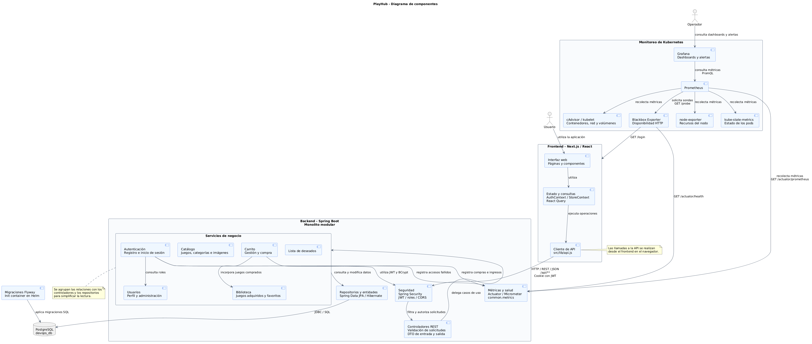

# PlayHub - Laboratorio 4: trabajo integrador DevOps {#mainpage}

PlayHub es una aplicación académica de catálogo y compra de videojuegos. Permite registrarse, iniciar sesión, consultar juegos, utilizar un carrito, completar compras, administrar una biblioteca y mantener una lista de deseados. Los administradores pueden gestionar usuarios y catálogo.

Esta es la documentación central de la entrega: describe los contenedores, el despliegue con Kubernetes y Helm, la observabilidad y la seguridad presentes en el repositorio. El recorrido de ejecución de esta guía utiliza Kubernetes con Minikube.

## Índice

- [Guías y evidencias](#guías-y-evidencias)
- [Arquitectura del proyecto](#arquitectura-del-proyecto)
- [1. Contenedores e imágenes](#1-contenedores-e-imágenes)
- [2. Iniciar el proyecto con Kubernetes y Helm](#2-iniciar-el-proyecto-con-kubernetes-y-helm)
- [3. Integración y entrega continua - Jenkins](#3-integración-y-entrega-continua---jenkins)
- [4. Monitoreo y observabilidad](#4-monitoreo-y-observabilidad)
- [5. Seguridad integrada y resultados disponibles](#5-seguridad-integrada-y-resultados-disponibles)
- [6. Problemas encontrados y soluciones adoptadas](#6-problemas-encontrados-y-soluciones-adoptadas)
- [7. Detener y limpiar](#7-detener-y-limpiar)
- [8. Conclusiones y oportunidades de mejora](#8-conclusiones-y-oportunidades-de-mejora)
- [9. Generar la documentación con Doxygen](#9-generar-la-documentación-con-doxygen)

## Guías y evidencias

| Documento | Contenido |
| --- | --- |
| [Guía de scripts](scripts/README.md) | Comandos Bash y PowerShell, parámetros, carga de tráfico, seguridad, diagnóstico y limpieza. |
| [Pipeline de Jenkins](jenkins/README.md) | Configuración del job, credenciales, parámetros, etapas, artefactos y límites de la implementación actual. |
| [Comandos de CI y despliegue](scripts/ci/README.md) | Publicación de imágenes, despliegue remoto, secretos, verificaciones y limpieza mediante los scripts existentes. |
| [Helm Chart](helm-chart/README.md) | Instalación, valores por entorno, recursos y persistencia. |
| [Monitoreo](docs/monitoring.md) | Dashboards, consultas, verificación de métricas y actualización de los JSON. |
| [Prometheus y Grafana](monitoring/README.md) | Componentes, recopilación de métricas e integración del monitoreo. |
| [Seguridad y resultados](docs/security.md) | Semgrep, Snyk, Trivy, Kyverno y Falco, con alcance y límites de los reportes. |
| [Análisis de imágenes](reports/image-analysis.md) | Medición con Dive, capas y oportunidades de optimización. |
| [Backend](docs/backend.md) y [frontend](docs/frontend.md) | Organización interna de la aplicación. |
| [Convenciones de documentación](docs/documentation-guide.md) | Criterios de documentación del código. |

Los documentos de `docs_EntregasAnteriores/` se conservan como antecedentes. Para ejecutar la versión actual, seguir este README y las guías enlazadas arriba.

## Arquitectura del proyecto

### Diagrama final de componentes



### Componentes presentes

- **Frontend:** Next.js y React. La URL pública de la API se configura al construir la imagen con `NEXT_PUBLIC_API_URL`.
- **Backend:** Spring Boot, Spring Security, JWT y acceso a datos mediante JPA. Expone OpenAPI/Swagger y métricas con Actuator y Micrometer.
- **Base de datos:** PostgreSQL con migraciones SQL versionadas. En Helm, un `initContainer` ejecuta Flyway antes de iniciar el backend.
- **Observabilidad:** Prometheus recolecta métricas de aplicación e infraestructura; Grafana consulta esos datos y provisiona los dashboards del repositorio.
- **Seguridad:** Kyverno aplica políticas de admisión y Falco observa eventos del runtime. Los scripts administran esas instalaciones como un stack compartido del clúster.

El recorrido principal utiliza el release `playhub` en el namespace `playhub-helm`. Kyverno y Falco utilizan los namespaces `kyverno` y `falco`. También existen manifiestos Blue/Green en `k8s/`, desplegados mediante `deploy.sh` / `deploy.ps1` en el namespace del contexto activo. Son modalidades distintas; ver [la guía de scripts](scripts/README.md).

## 1. Contenedores e imágenes

| Componente | Archivo de producción | Características presentes |
| --- | --- | --- |
| Backend | `backend/Dockerfile.prod` | Dos etapas: Maven compila y una imagen JRE ejecuta el JAR como usuario `spring`, UID 1000. |
| Frontend | `frontend/Dockerfile.prod` | Etapas de dependencias, compilación y ejecución; elimina dependencias de desarrollo y ejecuta como usuario `node`. |
| Migraciones auxiliares | `backend/Dockerfile.migrations` | Imagen Flyway con los SQL. El chart usa la imagen oficial y monta los SQL desde un ConfigMap. |

Las bases del backend y frontend están fijadas por digest. Los despliegues utilizan etiquetas explícitas, como `playhub-backend:v1.0` y `playhub-frontend:v1.0`.

El [análisis de Dive del 10 de noviembre de 2026](reports/image-analysis.md) registra **287,81 MiB y 9 capas** para backend, y **719,91 MiB y 11 capas** para frontend. Son medidas de las capas de las imágenes analizadas, no del tamaño comprimido de descarga ni de una reconstrucción posterior.

Las oportunidades identificadas incluyen reducir el runtime y el JAR del backend, excluir la caché de compilación del frontend y evaluar la salida `standalone` de Next.js. Son propuestas; el reporte no afirma que esas optimizaciones ya estén implementadas.

## 2. Iniciar el proyecto con Kubernetes y Helm

### Requisitos

- Docker en funcionamiento; en Windows, Docker Desktop.
- Minikube y `kubectl` instalados.
- Helm en `PATH`; el repositorio incluye un instalador.
- Python 3 para las utilidades de seguridad y limpieza. Las pruebas de Falco documentadas anteriormente utilizan Python 3.11 o superior.
- Para Bash: Bash 4 o superior, `curl`, `shuf` y Python 3. Para la demo en PowerShell: `curl.exe`.
- Acceso a los registros de imágenes y a los repositorios de instalación de Kyverno y Falco.
- Una StorageClass predeterminada para los PVC; Minikube incluye los complementos utilizados para ello.

Ejecutar desde la **raíz del repositorio**. Los scripts despliegan sobre un clúster existente: primero se inicia Minikube.

### Windows - PowerShell

```powershell
docker version
minikube start
kubectl config use-context minikube
.\scripts\install-helm.ps1
helm version --short
python --version
.\scripts\deploy-helm.ps1
```

### Bash

```bash
docker version
minikube start
kubectl config use-context minikube
bash scripts/install-helm.sh
export PATH="$HOME/.local/bin:$PATH"
helm version --short
python3 --version
bash scripts/deploy-helm.sh
```

El instalador permite elegir otra carpeta; si se cambia, agregarla a `PATH`. En Bash se invocan los archivos con `bash`, sin depender de su permiso de ejecución.

### Qué hace el despliegue

1. Construye las imágenes de producción y las carga en Minikube.
2. Valida el chart con `helm lint`.
3. Instala Kyverno, aplica las cuatro políticas e instala Falco, salvo que se solicite omitir la seguridad compartida.
4. Ejecuta `helm upgrade --install` con `values-dev.yaml`, release `playhub` y namespace `playhub-helm`.
5. Espera los recursos, muestra pods, servicios y PVC, y ejecuta `helm test`.
6. Abre los cuatro `port-forward` de la aplicación y el monitoreo.

Si Kyverno o Falco ya existen sin el marcador de propiedad de los scripts, el despliegue puede detenerse para conservar esa instalación. Las opciones para omitir o adoptar seguridad se explican en [scripts/README.md](scripts/README.md).

En desarrollo local, las credenciales provienen de `helm-chart/values.yaml`. Los scripts no cargan `.env` automáticamente. La variante Bash también permite pasar explícitamente un archivo con `--secrets-file`; su uso en CI se documenta en [scripts/ci/README.md](scripts/ci/README.md). El entorno `prod` exige credenciales y un secreto JWT de al menos 48 bytes UTF-8. Ver [helm-chart/README.md](helm-chart/README.md).

### Accesos y comprobaciones

| Servicio | Dirección con los port-forward predeterminados |
| --- | --- |
| Aplicación | [http://localhost:5745](http://localhost:5745) |
| Salud del backend | [http://localhost:8080/actuator/health](http://localhost:8080/actuator/health) |
| API interactiva | [http://localhost:8080/swagger-ui.html](http://localhost:8080/swagger-ui.html) |
| Métricas del backend | [http://localhost:8080/actuator/prometheus](http://localhost:8080/actuator/prometheus) |
| Prometheus | [http://localhost:9090](http://localhost:9090) |
| Grafana | [http://localhost:3000](http://localhost:3000) |

```bash
helm status playhub -n playhub-helm
kubectl get pods,svc,pvc -n playhub-helm
helm test playhub -n playhub-helm
```

El resultado esperado es que los pods de aplicación y monitoreo estén `Running` y listos, los PVC estén `Bound` y el test termine correctamente. El hook consulta la readiness del backend y `/login` del frontend; no reemplaza una prueba funcional completa ni los análisis de seguridad.

La migración `V2__demo_data.sql` incluye usuarios de demostración con contraseña `PlayHub123`: `facundo@playhub.test` y `santiago@playhub.test` son administradores; `agostina@playhub.test` y `agustin@playhub.test` son usuarios generales. Son datos de prueba, no credenciales destinadas a producción.

## 3. Integración y entrega continua - Jenkins

La definición actual está en `jenkins/Jenkinsfile`. Realiza checkout, análisis estático con Semgrep, build y verificación del backend, lint/build del frontend, y construcción y publicación de ambas imágenes. Backend y frontend se procesan en paralelo.

El tag combina número de build y commit corto. El frontend incorpora la URL pública durante su construcción, y el despliegue utiliza el mismo tag publicado.

El stage de Helm corre solamente con `DEPLOY=true`, cuyo valor predeterminado es `false`. Recibe kubeconfig y secretos desde credenciales Jenkins y utiliza el recorrido remoto de `scripts/deploy-helm.sh`. Ese recorrido omite el monitoreo Prometheus/Grafana del release; no se debe atribuir al clúster público el monitoreo que se demuestra en Minikube.

La [guía de la pipeline](jenkins/README.md) detalla herramientas, configuración del job, credenciales, parámetros, etapas y artefactos. Los [comandos de CI](scripts/ci/README.md) explican cómo usar los scripts fuera de Jenkins.

Quedan pendientes la incorporación de Snyk, el bloqueo de Semgrep por hallazgos y las decisiones sobre el agente y el monitoreo remoto. La documentación refleja el código actual; no se adjunta una ejecución nueva de Jenkins como evidencia.

## 4. Monitoreo y observabilidad

El backend expone `/actuator/prometheus` mediante Micrometer. La configuración permite `GET` a ese endpoint sin JWT y expone solamente `health` y `prometheus` de Actuator. Prometheus descubre los pods del backend y recolecta cada 15 segundos; las métricas incluyen etiquetas de pod y slot.

### Aclaración sobre los dashboards

Las métricas solicitadas **se distribuyen en varios dashboards personalizados**, en lugar de centralizarse en un único `grafana/dashboard.json`. Los JSON exportados están en `monitoring/grafana/dashboards/` y se cargan automáticamente en la carpeta **PlayHub** de Grafana.

| Archivo exportado | Métricas y propósito |
| --- | --- |
| `playhub-http-latency.json` | Peticiones por segundo (RPS), latencia promedio, percentiles y throughput por endpoint. |
| `playhub-workloads.json` | CPU y memoria por pod/contenedor, relación con límites y otras métricas de workloads. |
| `playhub-counters.json` | Métricas de negocio: compras e ingresos; también logins fallidos y errores HTTP 500. |
| `playhub-bluegreen.json` | Tráfico, disponibilidad y latencia por slot. Con Helm existe el slot `helm`, no dos slots Blue/Green. |
| `playhub-nodes.json` | CPU, memoria, disco y red del nodo. |

El datasource tiene UID `playhub-prometheus`. El chart empaqueta copias de los JSON bajo `helm-chart/files/grafana/dashboards/`. Los manifiestos sin Helm contienen los mismos dashboards en un ConfigMap. La [guía de monitoreo](docs/monitoring.md) explica cómo mantener esas copias y verificar las consultas.

### Generar datos para observar los paneles

Con la aplicación y los port-forward activos, ejecutar una variante:

```powershell
.\scripts\demo-monitoring.ps1
```

```bash
bash scripts/demo-monitoring.sh
```

El script crea usuarios sintéticos, genera consultas, compras, errores y carga concurrente, desactiva esos usuarios al terminar salvo que se solicite conservarlos y consulta Prometheus para verificar incrementos. La desactivación no borra el historial de compras generado.

Luego abrir Grafana, seleccionar la carpeta **PlayHub**, el namespace `playhub-helm` cuando exista ese selector y un intervalo reciente. Los contadores de negocio se reinician al reiniciarse el backend; no representan el total histórico de PostgreSQL. Sin tráfico, la latencia promedio puede aparecer sin datos o como un valor no definido.

En la comprobación realizada el **16 de noviembre de 2026** sobre el despliegue existente en `default`, se observaron 12 targets `UP`, métricas de CPU y memoria de cinco pods de aplicación y datos de RPS y latencia tras solicitudes de lectura. Es una comprobación de monitoreo, no una prueba de rendimiento ni una nueva instalación del chart.

## 5. Seguridad integrada y resultados disponibles

Los reportes corresponden a ejecuciones y alcances diferentes. El nombre `post-mitigacion` no demuestra por sí solo que todas las herramientas estén sin hallazgos. Los escáneres no se volvieron a ejecutar al redactar esta documentación.

| Herramienta | Archivo bajo `reports/` | Resultado y alcance |
| --- | --- | --- |
| Semgrep, referencia | `semgrep-report.txt` | Dos hallazgos: exposición de Actuator y escalada de privilegios de cAdvisor. |
| Semgrep, fuentes posteriores | `semgrep_scan-post-mitigacion.txt` | 164 reglas, 140 archivos y 8 hallazgos por hashes bcrypt de datos de demostración. |
| Semgrep, Kubernetes posterior | `semgrep-kubernetes-post-mitigacion.txt` | 11 reglas, 24 archivos y 16 hallazgos; incluye privilegios de monitoreo y filesystem escribible. |
| Snyk | `snyk-report.txt` | 6 issues: 2 críticas, 1 alta, 2 medias y 1 baja. Conserva dependencias anteriores a algunos cambios del POM. |
| Trivy | `trivyreports_backend-post-mitigacion.txt` y `trivyreports_frontend-post-mitigacion.txt` | Los reportes posteriores muestran cero vulnerabilidades en los objetivos analizados. No sustituyen una nueva ejecución de Snyk. |
| Kyverno | `kyvernovalidation.log` y `kyverno-validation-post-mitigacion.txt` | Evidencia de admisión y rechazo; la validación posterior registra 45 comprobaciones correctas. |
| Falco | `falcoevent.log` y `falco/falco-symlink-report-2026-11-15_21-42-48.txt` | Alerta por un enlace simbólico hacia `/etc/shadow`, sin shell interactiva ni lectura del archivo. |

Las cuatro políticas de `k8s/kyverno/` prohíben imágenes `latest` o sin versión explícita, exigen CPU y memoria, impiden ejecución como root y exigen `allowPrivilegeEscalation: false`. Las excepciones delimitadas para DaemonSets de monitoreo y los resultados se explican en [docs/security.md](docs/security.md).

**Nombres de las evidencias:** el validador escribe `reports/kyvernovalidation.log`, sin guion. La prueba válida de Falco escribe `reports/falcoevent.log`, también sin guion. `reports/falco-event.log` conserva una prueba anterior de shell, que no se utiliza aquí como evidencia del requisito de Falco del laboratorio 4. La guía de scripts incluye cómo copiar una nueva evidencia válida a los nombres pedidos por la consigna, después de verificarla.

## 6. Problemas encontrados y soluciones adoptadas

| Problema o restricción | Solución presente o estado documentado |
| --- | --- |
| Herramientas de build en las imágenes de ejecución | Builds por etapas; las oportunidades de reducción restantes están medidas en el informe de Dive. |
| Métricas de CPU, memoria y red con etiquetas Kubernetes en el entorno local | Scrape de kubelet/resource y exporters; cAdvisor auxiliar para red. |
| Conflicto entre node-exporter de manifiestos y otro release Helm | El chart calcula un puerto por release y namespace, configurable en `values.yaml`. |
| Checksums de Flyway dependientes de los bytes de los SQL | `.gitattributes` fija LF para migraciones; el despliegue por manifiestos preserva UTF-8 al generar el ConfigMap. |
| Instalaciones de seguridad preexistentes | Marcadores de propiedad y opciones para omitir o adoptar instalaciones compatibles. |
| Privilegios de cAdvisor/Falco | Excepciones de admisión acotadas a DaemonSets e identidad del controlador; se conservan los hallazgos estáticos. |
| Reportes de fechas o alcances diferentes | Se indica qué demuestra cada archivo, sin declarar corregido un reporte que no se volvió a generar. |
| Cambio de URL de la API en el frontend | Se incorpora durante el build; cambiar solo el ConfigMap no modifica una imagen ya construida. |

## 7. Detener y limpiar

Para retirar el release y sus port-forward, conservando los datos:

```powershell
.\scripts\cleanup-helm.ps1
```

```bash
bash scripts/cleanup-helm.sh
```

Para revisar una limpieza completa antes de ejecutarla:

```powershell
.\scripts\cleanup-helm.ps1 -DeleteData -DeleteNamespace -RemoveImages -RemoveSecurity -WhatIf
```

```bash
bash scripts/cleanup-helm.sh --delete-data --delete-namespace --remove-images --remove-security --dry-run
```

Quitar `-WhatIf` / `--dry-run` ejecuta esa limpieza y **borra los datos** de PostgreSQL, Prometheus y Grafana. La seguridad compartida solo se retira si está registrada como propiedad de PlayHub y no se detectan recursos ajenos que impidan eliminarla. Los namespaces de seguridad se conservan.

`cleanup.sh` corresponde a los manifiestos Blue/Green; para un release Helm se utiliza `cleanup-helm`. Las variantes están en [scripts/README.md](scripts/README.md).

## 8. Conclusiones y oportunidades de mejora

El repositorio integra contenedores, despliegue parametrizable con Helm, métricas de aplicación e infraestructura y controles de seguridad de código, dependencias, admisión y runtime. Los dashboards presentan indicadores técnicos y de negocio mediante varias vistas complementarias.

Las evidencias muestran límites concretos: Snyk conserva críticas pendientes de una nueva verificación, Semgrep y KubeLinter registran hallazgos residuales y algunos nombres de reportes difieren de la consigna. Estas diferencias se documentan sin reemplazar ni inventar resultados.

Las mejoras identificadas son medir las optimizaciones propuestas por Dive, volver a ejecutar Snyk sobre las dependencias actuales, revisar los hallazgos residuales y migrar las `ClusterPolicy` cuyo uso aparece deprecado en los logs de Kyverno. La configuración `prod` requiere adaptar credenciales, acceso a imágenes e Ingress al entorno de destino; por sí sola no acredita un despliegue de producción validado.

## 9. Generar la documentación con Doxygen

Con Doxygen instalado, ejecutar desde la raíz:

```bash
doxygen Doxyfile
```

El nombre del archivo es `Doxyfile`, respetando mayúsculas y minúsculas. La salida se abre en `docs/generated/html/index.html`. El README central se utiliza como portada e incluye navegación a las guías de la pipeline, comandos de CI, scripts, Helm, monitoreo, seguridad, análisis de imágenes y arquitectura del código.

Los HTML son archivos generados y están excluidos de Git. Se editan los Markdown y el código fuente, y luego se vuelve a ejecutar Doxygen. No hace falta iniciar Kubernetes para generar esta documentación.
